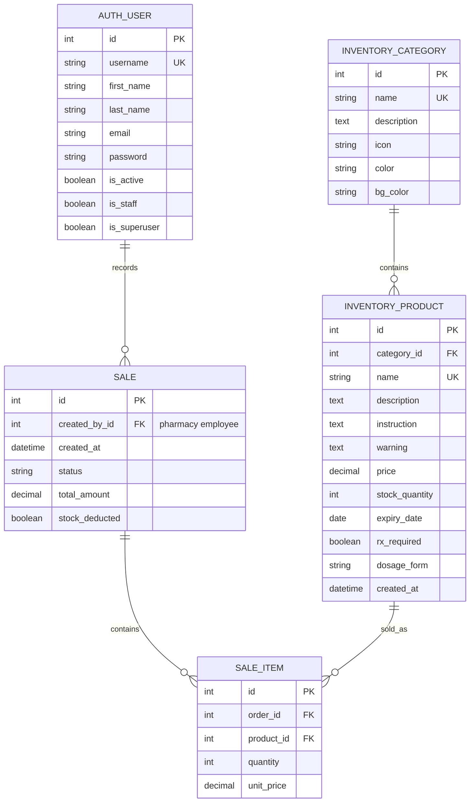

# ERD — система управління фармацевтичним складом PharmManager

Діаграма відображає складський облік і роздрібні продажі аптеки. Покупця як облікову сутність система не веде. Сутність `AUTH_USER` — працівник аптеки, який увійшов у систему та зафіксував продаж. Системні таблиці сесій, дозволів і журналу адміністратора не показані.

## Зв’язки та правила видалення

- Один працівник може зафіксувати багато продажів; кожен продаж належить одному працівнику. У коді це поле `Order.created_by`, а у фізичній схемі — `inventory_order.created_by_id`.
- Одна категорія містить багато товарів; видалення категорії каскадно видаляє її товари.
- Один продаж містить позиції продажу, кожна з яких посилається на один товар. У Django-коді вони називаються `Order` і `OrderItem`, а фізичні таблиці — `inventory_order` та `inventory_orderitem`; у предметній області це продаж і його рядки, не клієнтське замовлення.
- Видалення продажу або товару каскадно видаляє пов’язані позиції.
- `unit_price` зберігає ціну товару на момент продажу; `total_amount` зберігає суму продажу.

## Уточнення щодо ролі фармацевта

У поточних моделях немає окремої сутності чи поля ролі «фармацевт»: `created_by` посилається на стандартного Django-користувача. Представлення продажу перевіряє, що користувач увійшов (`login_required`), але не обмежує дію окремою роллю фармацевта. Отже, ERD точно показує наявну структуру даних; обмеження продажу лише фармацевтам потребує окремої рольової перевірки в коді.
